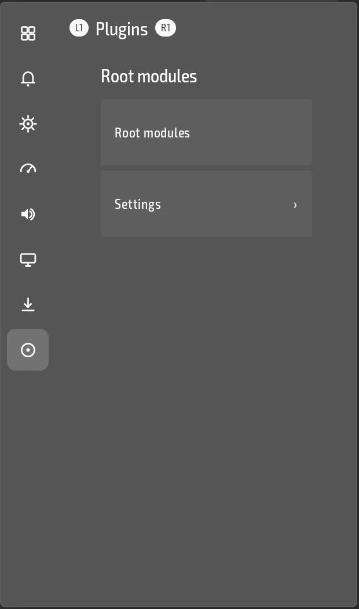

<h1 align="center">Root modules for droidtop</h1>

  <b>Magisk, KernelSU and APatch modules, from droidtop.</b> 
  Status and settings rows for your modules, and nothing at all when the device has no root.

  
  
  
  

  

  <a href="#what-the-droidtop-plugin-does">What it does</a> ·
  <a href="#install">Install</a> ·
  <a href="#status">Status</a> ·
  <a href="#licence">Licence</a> ·
  <a href="#upstream-readme">Upstream README</a>

This is a fork of [MMRL](https://github.com/MMRLApp/MMRL) with a [droidtop](https://github.com/Droidtop/droidtop) plugin added in `droidtop-plugin/`. The plugin ports MMRL's module handling and leaves out MMRL's own screens.

## What the droidtop plugin does

- **Lists your modules** and tells you which root solution is present: Magisk, KernelSU or APatch.
- **Enable, disable, remove, check for updates, and install** a module from a zip address.
- **Hides itself cleanly** when there is no root solution. It does not nag you to root the device.

It needs root, because managing root modules is its whole purpose. Nothing else in droidtop depends on it.

## Install

You need [droidtop](https://github.com/Droidtop/droidtop). You need a device that already has Magisk, KernelSU or APatch.

1. In droidtop open **Settings > Plugins > Add**. droidtop's own catalog is always there.
2. Pick **Root modules** and press **Install**.
3. Read the permissions it asks for and press **Accept**. Nothing runs until you do.

You can also browse the catalog at [droidtop.github.io](https://droidtop.github.io/), or open this plugin's install page directly: [Install in droidtop](https://droidtop.github.io/install-plugin?catalog=https%3A%2F%2Fraw.githubusercontent.com%2Fdroidtop%2Fdroidtop-platforms%2Fmain%2Fdroidtop-plugins%2Findex.json&id=droidtop.mmrl-modules). That link only opens a review inside droidtop.

## Status

Early. The catalog lists builds of this plugin, but there is no stable release yet, and droidtop installs from the stable stream only. The code is in `droidtop-plugin/`.

## Licence

GPL-3.0, like upstream MMRL, see [LICENSE](LICENSE) and [NOTICE](NOTICE).

---

## Upstream README

The rest of this page is the README of [MMRL](https://github.com/MMRLApp/MMRL), kept as it is.

---

# MMRL

An app for managing, sharing, and exploring Magisk modules across repositories.

## Features

- **Comprehensive Root Manager Support**: Full compatibility with Magisk, KernelSU, and APatch for diverse root management options.
- **WebUI with Advanced Features**: Includes [Edge-to-Edge](https://developer.android.com/develop/ui/compose/layouts/insets) support and dynamic app themes for a seamless user experience.
- **Bulk Installation Support**: Effortlessly install modules in bulk, both online and locally.
- **Module Dependency Management**: Simplifies module installation for end-users by automatically handling module dependencies.
- **Magisk Modules Repositories**: A community-driven platform that allows anyone to contribute and access Magisk modules.
- **User Transparency with Blacklist**: Clear visibility into which modules or actions are restricted, ensuring users can make informed decisions.
- **Customizable Module Pages**: Personalize module pages with categories, screenshots, icons, covers, and other content for a tailored presentation.
- **Transparency of Included Files**: Detailed breakdown of all files within modules, including APKs, service files, and more, for full user awareness.
- **Analytics Dashboard**: Display module-related analytics on the homepage, offering valuable insights into module usage and trends.

## Preview

  
  
  
  
  
  

## Supported Versions

- Android 8.0 ~ 14
- Magisk 24.0 ~ latest
- KernelSU 0.5.1 ~ latest
- APatch 10253 ~ latest

## Translate

Get involved with MMRL by translating it into your language!

## Modules Repository

- [MMRLApp/MMRL-Util](https://github.com/MMRLApp/MMRL-Util): A command line interface for building modules repository

## Credits

- [tabler/tabler-icons](https://github.com/tabler/tabler-icons.git)
- [MRepoApp/MRepo](https://github.com/MRepoApp/MRepo)
- [topjohnwu/libsu](https://github.com/topjohnwu/libsu)

## Fork status

This repo mirrors upstream [MMRLApp/MMRL](https://github.com/MMRLApp/MMRL)
for droidtop plugin work (see `PLUGIN-PLAN.md`). It is an official droidtop
plugin fork, kept in sync with upstream, not a place for droidtop's own
patches beyond the `droidtop-plugin/` wrapper.

Branches:
- `upstream-main` tracks upstream's `master` exactly (fast-forward only,
  synced daily by `.github/workflows/sync-upstream.yml`).
- `main` is where plugin/integration work happens; the sync workflow merges
  `upstream-main` into it automatically when there's no conflict, and opens
  an issue here instead of forcing anything when there is one.

### Licence

MMRL is GPL-3.0 (see `LICENSE`). Same as ReVanced Manager: GPL-3.0's
copyleft obligation is to offer the modified source to anyone the software is
distributed to, which this public repo already satisfies; `LICENSE` and
copyright notices stay intact.

### Why MMRL over other Magisk module managers

Picked over alternatives found in the same search: `yunncheng/MMRL` is a
differently-scoped, far smaller project sharing only the name; the various
"Alt-Repo"/"Rikj000" results are module *repositories* (JSON indexes of
modules), not manager apps, so they're not a fit for this slot at all. MMRL
(MMRLApp/MMRL, 2.1k+ stars) is the most actively maintained manager app in
this space: it supports Magisk, KernelSU, and APatch as interchangeable root
providers (`platform/`, `compat/`), ships its own CLI and WebUI-X companion
projects, and has a template-repository project for anyone hosting a module
repo — evidence of a real ecosystem around it rather than a one-person tool
that might go stale.
